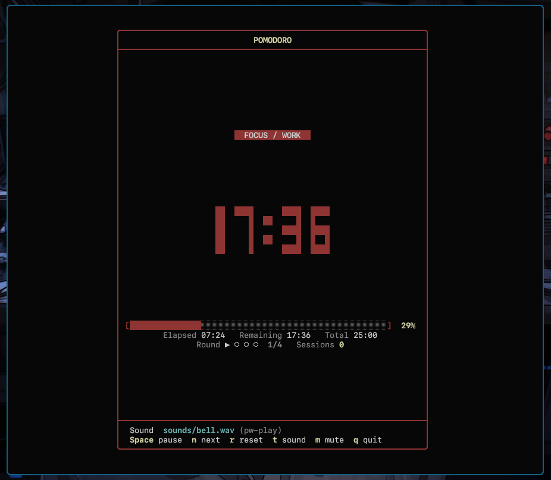

# Pomodoro TUI

A single-file Pomodoro timer for your terminal, written in C99. No runtime dependencies, no bloat — just a big block-digit clock, a progress bar, and a chime when time is up.



## Features

- **Big block-digit clock** with a live progress bar and elapsed/remaining/total breakdown
- **Work → short break → long break** cycles with a configurable number of rounds
- **Session tracker** showing which round you're on and how many sessions you've completed
- **Sound alert** when the timer hits zero — auto-detects your audio player
- **Pause, skip, reset, and adjust** the current phase without restarting
- **UTF-8 aware layout** — the box borders stay aligned even with wide characters
- **Responsive** — redraws on terminal resize (`SIGWINCH`)
- **Single source file**, ~860 lines, compiles with a plain `gcc` command

## Requirements

- A C99 compiler (`gcc` or `clang`)
- POSIX system (Linux, macOS, BSD) — uses `termios` and `poll`
- *Optional:* one of `pw-play`, `paplay`, `aplay`, `mpv`, `ffplay`, `canberra-gtk-play`, or `afplay` for sound. Without one, the terminal bell is used instead.

## Build

### Make

```sh
make            # builds ./pomodoro and generates sounds/bell.wav
./pomodoro
```

### CMake

```sh
cmake -B build
cmake --build build
./build/pomodoro
```

### Plain compiler

```sh
gcc -O2 -Wall -Wextra -pedantic -std=c99 pomodoro.c -lm -o pomodoro
```

### Install

```sh
sudo make install                    # installs to /usr/local/bin
sudo make install PREFIX=/usr        # or somewhere else
sudo make uninstall
```

## Usage

```sh
./pomodoro                          # 25 / 5 / 15 defaults
./pomodoro -w 50 -b 10 -l 20 -c 3  # custom durations
./pomodoro -s ~/chime.mp3            # custom sound
./pomodoro --test-sound             # check audio setup and exit
./pomodoro --help
```

| Option | Default | Description |
| --- | --- | --- |
| `-s`, `--sound <path>` | `sounds/bell.wav` | Sound file to play when time is up |
| `-w`, `--work <min>` | `25` | Work session length in minutes |
| `-b`, `--break <min>` | `5` | Short break length in minutes |
| `-l`, `--long-break <min>` | `15` | Long break length in minutes |
| `-c`, `--cycles <count>` | `4` | Work sessions before a long break |
| `-p`, `--player <cmd>` | auto-detect | Force a specific audio player |
| `-m`, `--mute` | off | Start with audio muted |
| `-t`, `--test-sound` | — | Test sound playback and exit |
| `-h`, `--help` | — | Show help and exit |

Environment variables: `POMODORO_SOUND` (sound file) and `POMODORO_AUDIO_PLAYER` (preferred player) act as fallbacks for the matching flags.

## Keybindings

| Key | Action |
| --- | --- |
| `Space` | Pause / resume (or dismiss the "time's up" alert) |
| `n` / `Enter` | Skip to the next phase |
| `r` | Reset the current phase |
| `t` | Test sound playback |
| `m` | Toggle mute |
| `+` / `-` | Add or subtract a minute |
| `q` / `Esc` | Quit |

## Sound

`make` generates `sounds/bell.wav` from scratch if it doesn't exist — a two-tone synthesized chime, so no binary asset has to be committed. Any format your player supports works (`wav`, `mp3`, `ogg`, `flac`, …), so you can point `-s` at whatever you like.

To force a specific player:

```sh
./pomodoro -p mpv -s /path/to/chime.mp3
```

## Project structure

```
.
├── pomodoro.c       # the entire timer
├── Makefile         # make build, install, test-sound
├── CMakeLists.txt   # cmake build
├── build.sh         # one-shot build script
└── sounds/
    └── bell.wav     # generated default chime
```

## License

MIT
